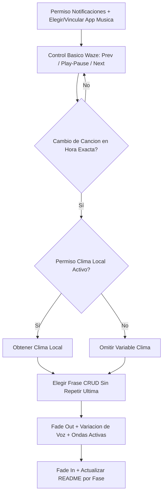

### Diagnóstico Rápido: Por qué no funcionaron los botones ni pidió servicio de música

1. **No se vinculó ni seleccionó un reproductor/servicio de música:** Aunque la app pidió permiso de notificaciones (`NotificationListenerService`), el flujo no resolvió una sesión activa ni le permitió al usuario elegir/vincular su app de música preferida (o detectar y fijar la sesión activa de `MediaSessionManager`), dejando `MediaController` nulo o sin sesión seleccionada al pulsar **Anterior**, **Reproducir/Pausar** o **Siguiente**.
2. **Ícono pendiente de `stitch/ICON .PNG`:** El ícono creado en `stitch/ICON .PNG` aún no se integró como recurso/ícono de la app ni de la cabina.
3. **Locución repetitiva y falta de menú CRUD de frases / clima:** Faltan variaciones de voz reales/seleccionables, rotación anti-repetición, un menú dedicado con **CRUD completo** para editar/crear/eliminar frases del locutor, y un módulo opcional de **clima local** condicionado a permiso explícito del usuario (además de ubicación si se consulta clima en tiempo real).

---

### 1. Objetivo general

Consolidar y corregir **`I AM-FM: Locutor Radio`** mediante flujo CLI para que la cabina de cuatro vistas (*Cabina*, *Ajustes*, *Historial*, *Servicio*) enlace correctamente el servicio de música elegido o detectado del teléfono haciendo funcionales los botones de control, integre `stitch/ICON .PNG`, ofrezca variaciones de voz y rotación de frases sin repetir, incluya un menú independiente con **CRUD** de frases e incorpore de forma opcional y bajo permiso el **clima local**.

---

### 2. Problema que resuelve

* **Botones de canción inoperativos por falta de vinculación:** Al no seleccionar/enlazar la app de música ni observar cambios de sesión activa (`getActiveSessions`), los comandos de transporte no llegan a ningún reproductor.
* **Repetición de locuciones:** Tener una sola plantilla provoca que el locutor diga siempre lo mismo; se requiere rotación de múltiples frases, variaciones de voz y un menú **CRUD** administrable por el usuario.
* **Contexto ambiental opcional:** Permitir mencionar el **clima local** solo cuando el usuario otorgue permiso explícito (ubicación/clima), manteniendo control de privacidad y un *fallback* limpio si el permiso está denegado.

---

### 3. Usuarios y contexto

* **Usuario objetivo:** Conductores y oyentes en Android que quieren controlar su app de música (Spotify, YouTube Music, Apple Music, MP3, etc.), elegir o enlazar su servicio musical, usar el botón central con ondas reactivas y escuchar un locutor con variedad de frases, *fade* previo y mención opcional del clima local.
* **Contexto de ejecución:** Desarrollo y compilación desde CLI en Linux (`Zorin OS`) con Android SDK, tomando como referencia los HTML de `stitch/` y el recurso `stitch/ICON .PNG`.

---

### 4. Solución propuesta

1. **Selector y enlace de servicio de música + control funcional:** Permitir que la app pregunte/permita elegir qué app de música vincular (ej. Spotify, YouTube Music, Apple Music, MP3 o *Detección automática*) y observe `MediaSessionManager.addOnActiveSessionsChangedListener(...)` tras conceder `BIND_NOTIFICATION_LISTENER_SERVICE`, asegurando que **Anterior**, **Reproducir/Pausar** y **Siguiente** envíen comandos al `MediaController` seleccionado o activo.
2. **Integración de `stitch/ICON .PNG`:** Copiar `stitch/ICON .PNG` a recursos drawables/mipmap del proyecto para usarlo como ícono de aplicación y emblema en la cabina.
3. **Variaciones de voz, rotación sin repetir y menú CRUD de frases:**
* Soporte para múltiples voces/perfiles TTS disponibles en el dispositivo (variación de *voice* / *locale* / tono / velocidad por estilo de locutor).
* Menú independiente **Frases (CRUD)** para **Crear**, **Leer/Listar**, **Actualizar/Editar** y **Eliminar** plantillas de locución (con variables `{cancion}`, `{artista}`, `{hora}`, `{clima}`), seleccionando al azar sin repetir la última frase usada (`lastUsedPhraseId`).


4. **Clima local bajo permiso explícito:** Interruptor de permiso para clima local (solicitando permiso de ubicación si aplica y respetando si el usuario lo niega) para inyectar `{clima}` en las frases cuando esté habilitado.

---

### 5. Arquitectura sugerida

* **Referencia visual y assets (`stitch/`):** HTML base y `stitch/ICON .PNG`.
* **Capa de Sistema (`service/`):** `MediaMonitorNotificationListener` y `RadioAnnouncerForegroundService`.
* **Capa de Datos (`data/`):**
* `media/MusicServiceLinker.kt` y `MediaSessionRepository.kt`: vinculación explícita de app musical + escucha continua de sesiones activas.
* `audio/AudioFadeController.kt`: *fade out* / *fade in* y foco de audio antes y después de hablar.
* `voice/AndroidTtsVoiceEngine.kt`: selección de voces TTS instaladas, modulación y callbacks de amplitud para ondas.
* `phrases/PhraseCrudRepository.kt`: almacenamiento local (DataStore/Room/JSON) con operaciones **CRUD** y rotación sin repetir.
* `weather/LocalWeatherProvider.kt`: consulta de clima local únicamente si el usuario habilita el permiso correspondiente.


* **Capa de UI (`ui/`):** Cabina, *Frases (CRUD)*, *Ajustes*, *Historial* y *Servicio*.

---

### 6. Estructura del proyecto

```text
I-AM-FM-Locutor-Radio/
├── stitch/
│   ├── ICON .PNG
│   └── *.html
├── app/
│   ├── src/
│   │   ├── main/
│   │   │   ├── java/com/myastron/iamfm/
│   │   │   │   ├── MainActivity.kt
│   │   │   │   ├── IAmFmApplication.kt
│   │   │   │   ├── data/
│   │   │   │   │   ├── audio/
│   │   │   │   │   │   └── AudioFadeController.kt
│   │   │   │   │   ├── media/
│   │   │   │   │   │   ├── MediaSessionRepository.kt
│   │   │   │   │   │   ├── MusicServiceLinker.kt
│   │   │   │   │   │   └── PlatformResolver.kt
│   │   │   │   │   ├── phrases/
│   │   │   │   │   │   ├── RadioPhrase.kt
│   │   │   │   │   │   └── PhraseCrudRepository.kt
│   │   │   │   │   ├── preferences/
│   │   │   │   │   │   └── RadioPreferencesDataStore.kt
│   │   │   │   │   ├── voice/
│   │   │   │   │   │   ├── VoiceEngine.kt
│   │   │   │   │   │   └── AndroidTtsVoiceEngine.kt
│   │   │   │   │   └── weather/
│   │   │   │   │       └── LocalWeatherProvider.kt
│   │   │   │   ├── domain/
│   │   │   │   │   ├── model/
│   │   │   │   │   │   ├── TrackInfo.kt
│   │   │   │   │   │   ├── AudioWaveState.kt
│   │   │   │   │   │   └── AnnouncerConfig.kt
│   │   │   │   │   └── usecase/
│   │   │   │   │       ├── EvaluateHourlyAnnouncementUseCase.kt
│   │   │   │   │       └── GenerateRadioScriptUseCase.kt
│   │   │   │   ├── service/
│   │   │   │   │   ├── MediaMonitorNotificationListener.kt
│   │   │   │   │   └── RadioAnnouncerForegroundService.kt
│   │   │   │   └── ui/
│   │   │   │       ├── components/
│   │   │   │       │   ├── WazeMediaCard.kt
│   │   │   │   │       ├── ServiceSelectorDialog.kt
│   │   │   │   │       ├── CentralAnnouncerPowerButton.kt
│   │   │   │   │       └── SoundWaveRing.kt
│   │   │   │       ├── screens/
│   │   │   │       │   ├── CabinScreen.kt
│   │   │   │       │   ├── PhrasesCrudScreen.kt
│   │   │   │       │   ├── SettingsScreen.kt
│   │   │   │       │   ├── HistoryScreen.kt
│   │   │   │       │   └── ServiceHealthScreen.kt
│   │   │   │       └── RadioViewModel.kt
│   │   │   ├── res/
│   │   │   │   ├── drawable/
│   │   │   │   └── values/strings.xml
│   │   │   └── AndroidManifest.xml
│   │   └── build.gradle.kts
├── README.md
└── settings.gradle.kts

```

---

### 7. Flujo principal

1. **Permiso y vinculación de servicio:** Tras otorgar acceso a notificaciones, la app permite elegir qué app de música vincular (o usar detección automática) y enlaza el `MediaController` correspondiente.
2. **Control básico en Cabina:** El usuario opera **Anterior**, **Reproducir/Pausar** y **Siguiente** sobre el servicio vinculado/activo.
3. **Selección anti-repetición y clima opcional:** Al cambiar de canción en hora exacta, se elige una frase distinta a la anterior desde el repositorio **CRUD** y, solo si el usuario dio permiso de clima local, se incluye el dato meteorológico.
4. **Fade + Voz con variación + Ondas:** `AudioFadeController` atenúa el audio, se aplica la voz/modulación elegida, las ondas vibran alrededor del botón central y al terminar se restaura el volumen.
5. **Actualización del `README.md` por fase:** Se documenta qué cambió en cada fase con el formato progresivo (*qué era*, *qué es*, *qué será*), sin emojis y con *badges* de GitHub.

---

### 8. Decisiones clave

* **Vinculación explícita de servicio musical:** Preguntar/permitir elegir el servicio musical y escuchar `OnActiveSessionsChangedListener` evita que los botones queden desconectados.
* **Uso de `stitch/ICON .PNG`:** Integra el ícono propio creado en `stitch/` como identidad visual de la app.
* **Menú CRUD + rotación sin repetir:** Permite gestionar múltiples frases personalizadas y garantiza que no se repita exactamente la misma locución en dos intervenciones consecutivas.
* **Clima local condicionado a permiso:** Respeta la privacidad del usuario pidiendo permiso explícito antes de consultar clima/ubicación.

---

### 9. README draft

```markdown
# I AM-FM: Locutor Radio

[](https://kotlinlang.org/)
[](https://developer.android.com/compose)
[](https://developer.android.com/)
[](#)

## Descripción del Proyecto
`I AM-FM: Locutor Radio` es una aplicación nativa para Android (Kotlin y Jetpack Compose) con interfaz estilo Waze que controla de forma básica la reproducción activa de otras apps de música en el teléfono —sin exigir cuentas Premium ni integrar APIs musicales cerradas— e incorpora un locutor por voz que interviene al terminar una canción cuando coincide con una hora exacta, aplicando un fade previo para priorizar la locución.

## Especificaciones de Uso y Mantenimiento
- **Plataforma y compilación:** Android (`minSdk 26`), desarrollado y compilado mediante flujo CLI y Android SDK.
- **Referencia visual e ícono:** Basado en los archivos HTML de `stitch/` y en el ícono `stitch/ICON .PNG`.
- **Vinculación de servicio musical:** Permite seleccionar/vincular la app de música o detectar sesiones multimedia activas para operar los controles básicos (Anterior, Reproducir/Pausar y Siguiente, sin lista de reproducción).
- **Voz, frases y clima:** Soporta variaciones de voz, menú CRUD de frases sin repetir la última usada y mención de clima local únicamente con permiso explícito del usuario.
- **Mantenimiento:** Mantener desacoplados el enlace de sesión multimedia, el controlador de fade, el repositorio CRUD de frases, el motor de voz y el proveedor opcional de clima.

## Guía de Usuario y Funcionamiento General
1. **Permisos y servicio de música:** Concede acceso a notificaciones y selecciona o vincula tu servicio de música para habilitar los controles de Anterior, Reproducir/Pausar y Siguiente.
2. **Botón central y ondas:** Usa el botón central grande para encender o apagar al locutor y observa las ondas reactivas al sonido a su alrededor.
3. **Menú de frases (CRUD) y variaciones de voz:** Crea, edita, consulta o elimina frases personalizadas y alterna estilos/variaciones de voz para que el locutor no diga siempre lo mismo.
4. **Clima local opcional y fade:** Si otorgas permiso para clima local, el locutor puede incluirlo; al cerrar una canción en hora exacta, aplica fade previo para priorizar su voz y restaura el audio al terminar.

## Implementación Técnica
- **Enlace y control de sesiones:** `MusicServiceLinker` y `MediaSessionRepository` gestionan la app musical seleccionada y observan `MediaSessionManager` para despachar comandos básicos.
- **Priorización por fade:** `AudioFadeController` ejecuta fade out / fade in y foco de audio antes y después de la locución.
- **CRUD y rotación de frases:** `PhraseCrudRepository` almacena las frases del usuario y selecciona una distinta a la anterior (`lastUsedPhraseId`), integrando `{cancion}`, `{artista}`, `{hora}` y `{clima}` (si hay permiso).
- **Variaciones de voz y ondas:** `AndroidTtsVoiceEngine` selecciona voces/parámetros disponibles y emite niveles de modulación para animar las ondas alrededor del botón central.

## Manual de Desarrollo
Pendiente de redactar al finalizar todas las fases del proyecto.

### Cambio Principal de Esta Versión (Evaluación Progresiva)
- **Qué era:** Una versión donde el control multimedia pedía permiso de notificaciones pero no vinculaba explícitamente el servicio de música ni habilitaba el control efectivo, sin ícono `stitch/ICON .PNG`, sin menú CRUD de frases con rotación ni clima local opcional.
- **Qué es:** Una cabina en Kotlin/Compose con enlace/selección de servicio de música para controles básicos funcionales, ícono `stitch/ICON .PNG`, variaciones de voz, menú CRUD para gestionar frases sin repetición consecutiva, permiso opcional de clima local y fade previo de locutor.
- **Qué será:** Al avanzar a la siguiente iteración desde CLI, se evaluará esta versión frente al nuevo cambio para actualizar progresivamente qué era, qué es y qué será.

## Créditos
- **Autor:** MyAstron
- **Agentes de Inteligencia Artificial:**
  - Stitch
  - Gemini
  - Antigravity (CLI)
  - AI Studio

```

---

### 10. Manual técnico draft

* **Enlace de sesión (`MusicServiceLinker` + `MediaSessionRepository`):** Al recibir `onActiveSessionsChanged` o abrir el selector de servicio, emparejar `controller.packageName` con la app elegida por el usuario (o tomar la sesión activa más reciente en modo automático) y verificar `controller.playbackState?.actions` antes de enviar `skipToPrevious()`, `play()`/`pause()` o `skipToNext()`.
* **Rotación sin repetir (`PhraseCrudRepository`):** Filtrar frases activas excluyendo `lastUsedPhraseId` (si hay más de una frase disponible) y actualizar `lastUsedPhraseId` tras cada emisión.
* **Clima local condicionado a permiso:** Comprobar permiso de ubicación/clima antes de invocar `LocalWeatherProvider`; si no está concedido, omitir `{clima}` sin bloquear la locución.

---

### 11. Manual de usuario draft

1. Activa el acceso a notificaciones y elige o vincula tu app de música para usar **Anterior**, **Reproducir/Pausar** y **Siguiente**.
2. Usa el botón central grande para encender o apagar al locutor y mira las ondas alrededor al hablar o reproducir.
3. Entra al menú de **Frases** para crear, editar o borrar tus propias frases y activa **Clima local** solo si deseas darle permiso.

---

### 12. Diagrama de flujo sugerido



---

### 13. Siguientes pasos

1. Instruir a tu agente CLI para que copie `stitch/ICON .PNG` a `app/src/main/res/drawable/` y lo configure como ícono de la app y de la cabina.
2. Implementar `MusicServiceLinker` y el diálogo/selector de servicio musical conectándolo a `MediaSessionRepository` para que **Anterior**, **Reproducir/Pausar** y **Siguiente** funcionen sobre la app elegida.
3. Crear `PhraseCrudRepository`, `PhrasesCrudScreen`, la selección de variaciones de voz y `LocalWeatherProvider` bajo permiso explícito, actualizando el `README.md` con el cambio progresivo.