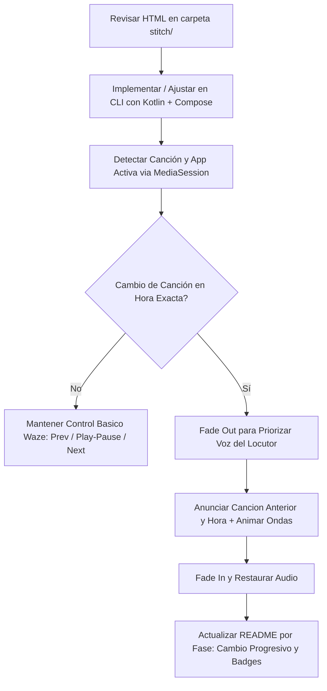

### 1. Objetivo general

Desarrollar la aplicación nativa para Android en Kotlin y Jetpack Compose llamada **`I AM-FM: Locutor Radio`**, operando desde flujo de trabajo CLI (Antigravity CLI / Gradle / Android SDK) y tomando como referencia visual inicial los archivos HTML ubicados en la carpeta **`stitch/`** del proyecto. La app ofrece control básico estilo Waze (**Anterior**, **Reproducir/Pausar** y **Siguiente**, sin lista de reproducción), un botón central grande de locutor (`ON / OFF`) rodeado de ondas reactivas al sonido y un *fade* previo para priorizar la voz al anunciar la canción finalizada y la hora exacta.

---

### 2. Problema que resuelve

* **Complejidad e imposición de APIs musicales:** Evita dependencias de cuentas Premium o SDKs propietarios cerrados utilizando sesiones multimedia nativas del sistema Android.
* **Falta de identidad de locución entre temas:** Añade anuncios hablados al cerrar canciones cuando coincide una hora exacta, con atenuación previa (*fade*) para que la voz del locutor tenga prioridad clara.
* **Desalineación entre referencia visual y código:** Centraliza los estados visuales iniciales en los archivos HTML de la carpeta `stitch/` para traducir su estructura, jerarquía y vibración visual a Jetpack Compose de forma ordenada desde CLI.

---

### 3. Usuarios y contexto

* **Usuario objetivo:** Oyentes en Android que usan una o varias apps de reproducción (Spotify, YouTube Music, YouTube, Apple Music, reproductores locales MP3) y buscan control básico rápido estilo Waze junto con un locutor horario automatizado.
* **Contexto de ejecución:** Desarrollo y compilación asistida por CLI sobre Linux (`Zorin OS`) y ejecución en dispositivo Android en primer o segundo plano (`ForegroundService`), manteniendo el `README.md` actualizado en cada fase sin emojis y con *badges* de GitHub.

---

### 4. Solución propuesta

Construir una arquitectura modular en **Kotlin + Jetpack Compose** guiada por CLI en donde:

1. Los archivos **HTML en `stitch/**` sirven como referencia de estados visuales (pantalla principal, barra estilo Waze, botón central grande de locutor y ondas reactivas al sonido).
2. **`MediaMonitorNotificationListener` + `MediaSessionRepository**` leen la sesión activa y exponen únicamente los controles básicos estilo Waze (**Anterior**, **Reproducir/Pausar**, **Siguiente**), sin listas de reproducción.
3. **`AudioFadeController` + `VoiceEngine**` aplican el *fade* previo sobre el audio multimedia para priorizar la voz del locutor al anunciar la canción terminada y la hora exacta al cierre de pista.
4. El **`README.md`** mantiene la estructura definida: descripción del proyecto, especificaciones de uso/mantenimiento, guía de usuario y funcionamiento general, implementación técnica, manual de desarrollo (solo al terminar las fases), evolución progresiva del cambio principal (*qué era*, *qué es* y *qué será*) y créditos con agentes de IA (**Stitch**, **Gemini**, **Antigravity (CLI)** y **AI Studio**), usando *badges* de GitHub y **sin emojis**.

---

### 5. Arquitectura sugerida

Arquitectura **MVVM + Clean Architecture ligera orientada a servicios Android**, desacoplando la lectura de sesiones multimedia, el *fade* de audio, la síntesis de voz y la interfaz en Compose:

* **Referencia visual inicial (`stitch/`):** Archivos HTML que definen la disposición de la barra estilo Waze, el botón central grande (`ON / OFF`) y las ondas/anillos de vibración sonora.
* **Capa de Sistema (`service/`):**
* `MediaMonitorNotificationListener`: Extiende `NotificationListenerService` para acceder a `MediaSessionManager`.
* `RadioAnnouncerForegroundService`: Servicio persistente (`mediaPlayback`) para mantener el monitoreo y las locuciones en segundo plano.


* **Capa de Dominio (`domain/`):**
* `TrackInfo` y `AudioWaveState`: Representan los metadatos básicos de la pista actual/anterior, el estado de reproducción y la intensidad/vibración de las ondas.
* `EvaluateHourlyAnnouncementUseCase` y `GenerateRadioScriptUseCase`: Evalúan la hora exacta al cerrar canción y generan el texto del locutor.


* **Capa de Datos y Audio (`data/`):**
* `MediaSessionRepository`: Expone pista actual, pista anterior, plataforma de origen y dispara comandos básicos (**Anterior**, **Reproducir/Pausar**, **Siguiente**).
* `AudioFadeController`: Aplica *fade out* / *fade in* y foco de audio para priorizar la voz del locutor.
* `AndroidTtsVoiceEngine` (implementación de `VoiceEngine`): Sintetiza la voz del locutor y reporta progreso para modular las ondas.


* **Capa de UI (`ui/`):**
* `RadioViewModel` y `RadioMainScreen`: Traducen los estados visuales de `stitch/*.html` a componentes Compose (`WazeBasicControlBar`, `CentralAnnouncerPowerButton`, `SoundWaveRing`).


---

### 6. Estructura del proyecto

```text
I-AM-FM-Locutor-Radio/
├── stitch/
│   ├── index.html
│   ├── announcer-active.html
│   └── styles.css
├── app/
│   ├── src/
│   │   ├── main/
│   │   │   ├── java/com/myastron/iamfm/
│   │   │   │   ├── MainActivity.kt
│   │   │   │   ├── IAmFmApplication.kt
│   │   │   │   ├── data/
│   │   │   │   │   ├── audio/
│   │   │   │   │   │   └── AudioFadeController.kt
│   │   │   │   │   ├── media/
│   │   │   │   │   │   ├── MediaSessionRepository.kt
│   │   │   │   │   │   └── PlatformResolver.kt
│   │   │   │   │   ├── preferences/
│   │   │   │   │   │   └── RadioPreferencesDataStore.kt
│   │   │   │   │   └── voice/
│   │   │   │   │       ├── VoiceEngine.kt
│   │   │   │   │       └── AndroidTtsVoiceEngine.kt
│   │   │   │   ├── domain/
│   │   │   │   │   ├── model/
│   │   │   │   │   │   ├── TrackInfo.kt
│   │   │   │   │   │   ├── AudioWaveState.kt
│   │   │   │   │   │   └── AnnouncerConfig.kt
│   │   │   │   │   └── usecase/
│   │   │   │   │       ├── EvaluateHourlyAnnouncementUseCase.kt
│   │   │   │   │       └── GenerateRadioScriptUseCase.kt
│   │   │   │   ├── service/
│   │   │   │   │   ├── MediaMonitorNotificationListener.kt
│   │   │   │   │   └── RadioAnnouncerForegroundService.kt
│   │   │   │   └── ui/
│   │   │   │       ├── theme/
│   │   │   │       │   ├── Color.kt
│   │   │   │       │   ├── Theme.kt
│   │   │   │       │   └── Type.kt
│   │   │   │       ├── components/
│   │   │   │       │   ├── WazeBasicControlBar.kt
│   │   │   │       │   ├── CentralAnnouncerPowerButton.kt
│   │   │   │       │   └── SoundWaveRing.kt
│   │   │   │       ├── RadioViewModel.kt
│   │   │   │       └── RadioMainScreen.kt
│   │   │   ├── res/values/strings.xml
│   │   │   └── AndroidManifest.xml
│   │   └── build.gradle.kts
├── docs/
│   ├── MANUAL_TECNICO.md
│   └── MANUAL_USUARIO.md
├── README.md
└── settings.gradle.kts

```

---

### 7. Flujo principal

1. **Revisión visual desde `stitch/`:** Antes de cerrar cada pantalla en Compose, se inspeccionan los archivos HTML en `stitch/` para extraer estructura visual, jerarquía del botón central, diseño de ondas y barra de control estilo Waze.
2. **Detección de pista y control básico:** `MediaSessionRepository` detecta la canción activa y su app de origen, habilitando solo **Anterior**, **Reproducir/Pausar** y **Siguiente** (sin lista de reproducción).
3. **Cierre de canción y evaluación horaria:** Al cambiar de pista, `EvaluateHourlyAnnouncementUseCase` revisa si la hora actual está en punto y no fue anunciada aún.
4. **Fade previo y locución:** Si aplica, `AudioFadeController` atenúa el audio multimedia (*fade out*) para priorizar la voz, el locutor anuncia el tema anterior y la hora exacta mientras las ondas vibran, y al terminar se ejecuta *fade in*.
5. **Actualización en `README.md` por fase:** Al concluir cada fase desde CLI, se actualiza el `README.md` (sin emojis, con *badges* de GitHub) indicando qué se hizo, el cambio más importante y la evolución progresiva (*qué era*, *qué es* y *qué será*).

---

### 8. Decisiones clave

* **Carpeta `stitch/` como fuente de referencia visual (HTML):** Permite validar distribución, énfasis del botón central y comportamiento visual de las ondas en HTML antes de codificar su equivalencia en Jetpack Compose, evitando retrabajo de interfaz.
* **Control básico estilo Waze sin lista de reproducción:** Reduce complejidad y mantiene la app enfocada en controlar la reproducción actual (**Anterior**, **Reproducir/Pausar**, **Siguiente**) y el locutor.
* **Priorización con *fade* antes de hablar:** Evita que la voz del locutor compita bruscamente con la música al anunciar la hora.
* **Reglas estrictas del `README.md`:** Cero emojis, uso de *badges* de GitHub (`img.shields.io`), sección de *Manual de Desarrollo* reservada hasta terminar todas las fases y evaluación progresiva (*qué era*, *qué es* y *qué será*) en cada cambio.

---

### 9. README draft

```markdown
# I AM-FM: Locutor Radio

[](https://kotlinlang.org/)
[](https://developer.android.com/compose)
[](https://developer.android.com/)
[](#)

## Descripción del Proyecto
`I AM-FM: Locutor Radio` es una aplicación nativa para Android (Kotlin y Jetpack Compose) con interfaz estilo Waze que controla de forma básica la reproducción activa de otras apps de música en el teléfono —sin exigir cuentas Premium ni integrar APIs musicales cerradas— e incorpora un locutor por voz que interviene al terminar una canción cuando coincide con una hora exacta, aplicando un fade previo para priorizar la locución.

## Especificaciones de Uso y Mantenimiento
- **Plataforma y compilación:** Android (`minSdk 26`), desarrollado y compilado mediante flujo CLI y Android SDK.
- **Referencia visual inicial:** Los estados y layouts visuales base se toman de los archivos HTML ubicados en la carpeta `stitch/` del proyecto.
- **Requerimientos de cuenta:** No requiere suscripciones Premium ni cuentas de terceros; trabaja sobre la sesión multimedia activa del sistema.
- **Controles soportados:** Únicamente controles básicos estilo Waze (Anterior, Reproducir/Pausar y Siguiente), sin lista de reproducción.
- **Permisos y servicios:** Requiere acceso a notificaciones (`BIND_NOTIFICATION_LISTENER_SERVICE`), servicio en primer plano (`FOREGROUND_SERVICE_MEDIA_PLAYBACK`), notificaciones (`POST_NOTIFICATIONS`) y gestión de foco/volumen de audio.
- **Mantenimiento:** Conservar desacoplados el lector de `MediaSession`, `AudioFadeController`, el motor de voz y los componentes visuales de Compose para facilitar ajustes ante cambios del sistema Android o mejoras de voz.

## Guía de Usuario y Funcionamiento General
1. **Inspección y arranque:** Abre la aplicación, concede el permiso de acceso a notificaciones y mantén activo el servicio de monitoreo.
2. **Barra estilo Waze:** Visualiza la canción en curso y la aplicación de origen con los controles básicos de Anterior, Reproducir/Pausar y Siguiente (sin lista de reproducción).
3. **Botón central y ondas:** Usa el botón central grande para encender o apagar al locutor (`ON / OFF`) y observa las ondas alrededor del botón vibrando según la actividad del sonido y la locución.
4. **Fade y anuncio de hora exacta:** Cuando termina una canción y la hora está en punto (sin haberse anunciado aún en esa hora), la app aplica un fade para priorizar la voz del locutor, anuncia la canción terminada y la hora exacta, y restaura el audio al finalizar.

## Implementación Técnica
- **Traducción visual desde `stitch/`:** Los archivos HTML en `stitch/` definen la estructura visual y estados de referencia que se implementan en Jetpack Compose (`WazeBasicControlBar`, `CentralAnnouncerPowerButton` y `SoundWaveRing`).
- **Sesiones multimedia:** `MediaMonitorNotificationListener` y `MediaSessionRepository` observan `MediaSessionManager` para obtener metadatos, identificar la app de origen y ejecutar comandos básicos de transporte.
- **Priorización de voz con fade:** `AudioFadeController` aplica atenuación progresiva (fade out / fade in) y foco de audio antes y después de la locución.
- **Evaluación al cierre de pista:** Al cambiar de canción, se evalúa `LocalTime.now()` contra la hora exacta y `lastAnnouncedHour` para evitar repeticiones en la misma hora.

## Manual de Desarrollo
Pendiente de redactar al finalizar todas las fases del proyecto.

### Cambio Principal de Esta Versión (Evaluación Progresiva)
- **Qué era:** Una propuesta centrada en colas/listas de reproducción entre plataformas o pantallas sin priorización de voz con fade ni referencia visual HTML en `stitch/`.
- **Qué es:** Una app nativa Android en Kotlin/Compose con referencia visual en los HTML de `stitch/`, control básico estilo Waze (Anterior, Reproducir/Pausar, Siguiente, sin lista de reproducción), botón central grande con ondas reactivas al sonido, fade previo para priorizar la voz al anunciar la hora exacta al terminar una canción y actualización del README por fase con badges de GitHub y sin emojis.
- **Qué será:** Al avanzar a la siguiente fase o cambio relevante, esta sección evaluará el cambio anterior frente al nuevo para actualizar progresivamente qué era, qué es y qué será.

## Créditos
- **Autor:** MyAstron
- **Agentes de Inteligencia Artificial:**
  - Stitch
  - Gemini
  - Antigravity (CLI)
  - AI Studio

```

---

### 10. Manual técnico draft

* **Inspección de `stitch/*.html`:** Revisar estructura, clases/estados y jerarquía visual en `stitch/` antes de construir o modificar pantallas en Compose para asegurar fidelidad visual.
* **Control básico sin cola:** Exponer únicamente `skipToPrevious()`, `play()`/`pause()` y `skipToNext()` sobre el `MediaController` activo; no mantener estructuras de playlist ni cola de canciones en la UI.
* **Secuencia de locución con fade:** Al detectar cambio de canción en hora exacta no anunciada -> ejecutar `AudioFadeController.fadeOutForVoice()` -> modular ondas (`AudioWaveState`) y sintetizar locución con canción anterior + hora exacta -> ejecutar `AudioFadeController.fadeInAfterVoice()`.
* **Reglas documentales del README:** Sin emojis, badges con `img.shields.io`, `Manual de Desarrollo` habilitado solo al concluir todas las fases y evaluación progresiva (*qué era*, *qué es*, *qué será*) en cada iteración.

---

### 11. Manual de usuario draft

1. Abre **I AM-FM: Locutor Radio**, activa el permiso de acceso a notificaciones y habilita el servicio.
2. Usa la barra estilo Waze para retroceder, pausar/reproducir o avanzar de canción (sin lista de reproducción).
3. Pulsa el botón central grande para encender o apagar al locutor (`ON / OFF`) y observa las ondas reactivas al sonido a su alrededor.
4. Cuando termine una canción en hora exacta, la música hará un *fade* para dar prioridad a la voz del locutor, dirá qué canción terminó y la hora exacta, y volverá a su nivel al terminar.

---

### 12. Diagrama de flujo sugerido



---

### 13. Siguientes pasos

1. Inspeccionar los archivos HTML dentro de la carpeta **`stitch/`** para identificar todos los estados visuales (reposo, reproducción activa, locutor hablando y ondas).
2. Generar desde CLI la estructura base de `app/` en Kotlin + Jetpack Compose con la barra básica estilo Waze (**Anterior**, **Reproducir/Pausar**, **Siguiente**, sin lista de reproducción), el botón central grande y las ondas reactivas.
3. Implementar `AudioFadeController` y la evaluación horaria al cierre de cada canción, actualizando el `README.md` al cierre de cada fase con la evaluación progresiva (*qué era*, *qué es* y *qué será*).
